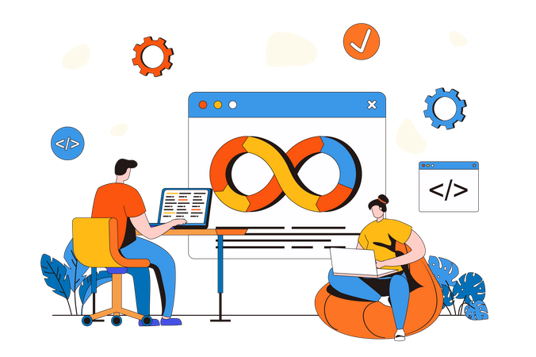

<div align="center">

<picture>
  <source media="(prefers-color-scheme: dark)" srcset="./dark.svg">
  <source media="(prefers-color-scheme: light)" srcset="./light.svg">
  
</picture>

<h1>Maaz Ghufran</h1>

<p><b>DevOps & Cloud Engineer (Entry-Level)</b><br>
Docker · Ansible · Linux · CI/CD · AWS · Terraform<br>
Growing into MLOps & Applied AI</p>

<p>
  <a href="https://www.linkedin.com/in/maaz-ghufran-777mz/"></a>
  <a href="https://github.com/maazsheikh039"></a>
  <a href="https://x.com/maazsheikh039"></a>
</p>

</div>

---

## About

<table border="0">
  <tr>
    <td width="62%" valign="center">

I build and automate infrastructure: containerized applications, CI/CD pipelines and Linux automation. I'm studying the **EduQual Level 6 Diploma in AIOps at Al Nafi** (Aug 2025 – Jan 2027) and I learn by building, so every lab I finish ends up in a repository below.

My goal is to deploy **AI systems in production** (MLOps and Applied AI), on top of a solid DevOps and cloud foundation.

📍 Karachi, Pakistan · 🔎 Looking for a DevOps / Cloud / MLOps internship or entry-level role (on-site or remote)

> *"I don't just want to manage infrastructure — I want to build intelligent systems that can observe, automate and improve it."*

</td>
    <td width="48%" align="center">
      
    </td>
  </tr>
</table>

## Featured Projects

| Project | What it covers | Stack |
| --- | --- | --- |
| **[Containerization Engineering](https://github.com/maazsheikh039/containerization-engineering)** | A collection of 9 hands-on container projects, from Dockerfile best practices to multi-tier applications and CI/CD | Docker · Linux · CI/CD |
| ↳ [Multi-Tier CI/CD Stack](https://github.com/maazsheikh039/containerization-engineering/tree/main/multi-tier-cicd-stack) | Multi-tier application with an automated build and deploy pipeline | Docker · CI/CD |
| ↳ [Secure Container Pipeline](https://github.com/maazsheikh039/containerization-engineering/tree/main/secure-container-pipeline) | Container build workflow with security practices built in | Docker · DevSecOps |
| ↳ [Multi-Container Application](https://github.com/maazsheikh039/containerization-engineering/tree/main/multi-container-application) | Several services running together, with custom networks and persistent volumes | Docker · Networking |
| ↳ [Multi-Node Cluster Stack](https://github.com/maazsheikh039/containerization-engineering/tree/main/multi-node-cluster-stack) | Containers running across multiple nodes | Docker · Linux |
| **[RHEL Ansible Automation](https://github.com/maazsheikh039/RHEL-ansible-automation)** | Automated configuration of RHEL servers with Ansible playbooks and templates | Ansible · RHEL · Linux |
| **[Ansible for DevOps](https://github.com/maazsheikh039/ansible-for-devops)** | Ansible labs: playbooks, roles and automation practice | Ansible · Python · Linux |
| **[Face Recognition App](https://github.com/maazsheikh039/FACE_RECOGNITION_APP)** | Early Applied AI / computer vision experiment | Python · HTML |

## Tech Stack

**Hands-on (used in my labs and repos)**

        

**Learning (Al Nafi AIOps track)**

     

## Currently Working On

| Area | Focus |
| --- | --- |
| **Al Nafi labs (Part 2)** | Continuing hands-on labs, published to GitHub as I complete them |
| **Cloud** | AWS services and infrastructure as code with Terraform |
| **Orchestration** | Kubernetes workloads, services and deployments |
| **MLOps / Applied AI** | Deploying ML models and LLM apps with Docker and CI/CD |

<details>
<summary><b>My learning path</b></summary>

```text
Linux → Python + Bash → Git + GitHub → Docker → Ansible → AWS → Terraform
→ Kubernetes → CI/CD → Monitoring & Observability → DevSecOps
→ MLOps → Applied AI
```

</details>

## GitHub Activity

<p align="center">
  
</p>

<p align="center">
  
</p>

## Engineering Philosophy

**Learn → Build → Automate → Monitor → Secure → Improve**

I focus on turning theory into practical systems through continuous experimentation, automation and real-world projects.

---

<p align="center">
  <i>"Automation is not about replacing people. It's about removing repetitive work so people can focus on creating."</i>
</p>
