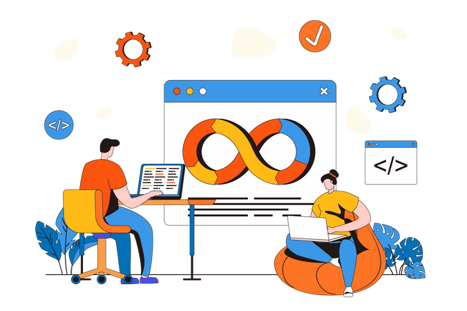

  <picture>
    <source media="(prefers-color-scheme: dark)" srcset="./dark.svg">
    <source media="(prefers-color-scheme: light)" srcset="./light.svg">
    
  </picture>
  <h1>Maaz Ghufran</h1>
  
<strong>DevOps & Cloud Engineer</strong> · Automation · Containers · Cloud Infrastructure · Applied AI

  
  
  

---

<table><tr><td width="66%" valign="top"><h2>Building dependable systems through automation.</h2>
I am an entry-level DevOps and Cloud engineer in Karachi, Pakistan. My work focuses on translating hands-on learning into practical repositories: Linux administration, Bash automation, Docker, Ansible, CI/CD, and cloud infrastructure.

I am currently completing the <strong>EduQual Level 6 Diploma in Artificial Intelligence Operations</strong> at Al Nafi International College, building toward production-ready <strong>MLOps and Applied AI</strong>.

<strong>Open to:</strong> DevOps, Cloud, AIOps, and MLOps internships or entry-level roles — on-site or remote.
</td><td width="34%" align="center" valign="middle"></td></tr></table>

## Core Capabilities

  

 

| Discipline | Current focus |
| --- | --- |
| **Infrastructure Automation** | Linux, Bash, Ansible playbooks, roles, and repeatable administration workflows |
| **Containers & Delivery** | Docker, multi-container applications, CI/CD, secure container practices |
| **Cloud & Platform Engineering** | AWS foundations, Terraform, Kubernetes workloads and deployments |
| **AIOps & MLOps** | Applying DevOps principles to intelligent systems, model delivery, and operations |
| **Security Engineering** | Practical SecOps automation and secure software delivery habits |

## Selected Engineering Work

<table>
  <tr>
    <td width="50%" valign="top">
      <h3>01 · AIOps Cloud Automation Suite</h3>
      
Python-focused work exploring automation patterns for cloud and operations workflows.

      <a href="https://github.com/maazsheikh039/aiops-cloud-automation-suite">View repository →</a>
    </td>
    <td width="50%" valign="top">
      <h3>02 · SecOps Python Toolkit</h3>
      
Security-oriented Python utilities and practical operations experiments.

      <a href="https://github.com/maazsheikh039/secops-python-toolkit">View repository →</a>
    </td>
  </tr>
  <tr>
    <td width="50%" valign="top">
      <h3>03 · Containerization Engineering</h3>
      
Nine hands-on Docker projects spanning multi-tier applications, networking, volumes, and CI/CD.

      <a href="https://github.com/maazsheikh039/containerization-engineering">View repository →</a>
    </td>
    <td width="50%" valign="top">
      <h3>04 · RHEL Ansible Automation</h3>
      
Automated RHEL server configuration using Ansible playbooks and Jinja templates.

      <a href="https://github.com/maazsheikh039/RHEL-ansible-automation">View repository →</a>
    </td>
  </tr>
  <tr>
    <td width="50%" valign="top">
      <h3>05 · Ansible for DevOps</h3>
      
A practical collection of playbooks, roles, and Linux automation labs.

      <a href="https://github.com/maazsheikh039/ansible-for-devops">View repository →</a>
    </td>
    <td width="50%" valign="top">
      <h3>06 · Face Recognition App</h3>
      
An early applied-AI and computer-vision experiment.

      <a href="https://github.com/maazsheikh039/FACE_RECOGNITION_APP">View repository →</a>
    </td>
  </tr>
</table>

## In Progress

<pre>
Linux & Automation     ██████████  Hands-on labs and reusable workflows
Containers & CI/CD     █████████░  Docker platforms and delivery pipelines
Cloud & IaC            ███████░░░  AWS and Terraform foundations
Kubernetes             ██████░░░░  Workloads, services, and deployments
MLOps & Applied AI     █████░░░░░  Learning through practical projects
</pre>

## GitHub Activity

  
   
  

---

  
<strong>Learn. Build. Automate. Monitor. Secure. Improve.</strong>

  
Interested in DevOps, cloud automation, or practical MLOps collaboration?

  

